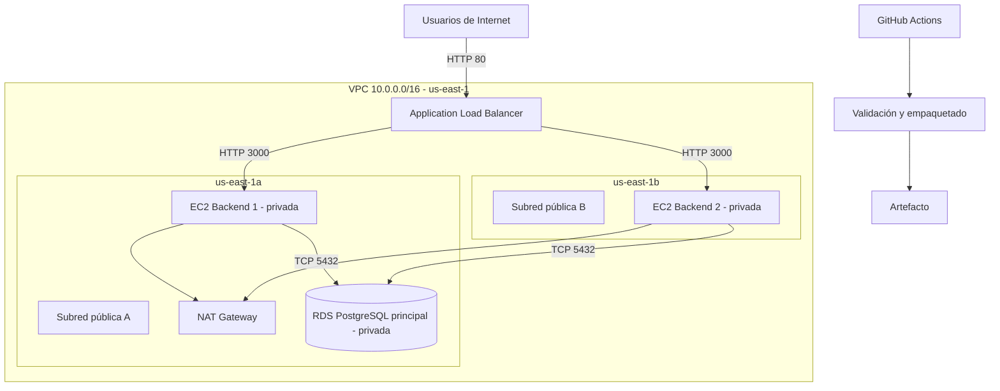

# Arquitectura desplegada — Tienda Modular

## 1. Objetivo

Desplegar la API de Tienda Modular en AWS Academy con disponibilidad en la capa de aplicación, distribución de tráfico, base de datos privada, controles de seguridad y administración de infraestructura mediante Terraform.

## 2. Componentes desplegados

- **VPC:** red `10.0.0.0/16` en la región `us-east-1`.
- **Zonas de disponibilidad:** `us-east-1a` y `us-east-1b`.
- **Subredes públicas:** alojan el Application Load Balancer y el NAT Gateway.
- **Subredes privadas:** alojan las dos instancias EC2 del backend y la base de datos RDS.
- **Application Load Balancer:** público, activo y distribuido entre dos subredes públicas. Listener HTTP en el puerto 80 y Target Group HTTP en el puerto 3000. Health check: `/api/health`.
- **Auto Scaling Group:** mínimo, deseado y máximo de dos instancias EC2 `t3.micro`, distribuidas entre las dos zonas y registradas en el Target Group.
- **Backend:** dos instancias EC2 privadas, sin exposición pública directa, que ejecutan la API en el puerto 3000.
- **RDS PostgreSQL:** instancia principal versión 16.13, clase `db.t3.micro`, almacenamiento gp3 cifrado de 20 GB, privada y Single-AZ. Tiene backups automáticos con retención de siete días y protección contra eliminación.
- **NAT Gateway:** permite conexiones salientes desde las subredes privadas. Se utiliza uno solo, lo que representa un punto único de salida.
- **Systems Manager Parameter Store:** almacena parámetros de configuración y secretos utilizados por la inicialización de las instancias.
- **GitHub Actions:** valida backend, frontend y Terraform, y prepara un artefacto. No realiza el despliegue automático a AWS.

## 3. Flujo de tráfico

1. El usuario accede al Application Load Balancer por HTTP, puerto 80.
2. El ALB distribuye las solicitudes entre las dos instancias EC2 saludables del Auto Scaling Group.
3. Las instancias del backend procesan las solicitudes por el puerto 3000.
4. El backend se conecta a la instancia principal de PostgreSQL por TCP 5432.
5. El Security Group de RDS solo permite conexiones cuyo origen sea el Security Group del backend.
6. Las instancias privadas pueden iniciar conexiones salientes mediante el NAT Gateway.
7. RDS no tiene acceso público y no acepta conexiones directas desde Internet.

## 4. Diagrama lógico

Para la entrega visual, se puede recrear este esquema en diagrams.net con los iconos oficiales de AWS. El diagrama representa los recursos efectivamente desplegados; no incluye una réplica de base de datos inexistente.

## 5. Seguridad de red

- El ALB acepta conexiones públicas por HTTP 80.
- El Security Group del backend solo admite TCP 3000 desde el Security Group del ALB.
- El Security Group de PostgreSQL solo admite TCP 5432 desde el Security Group del backend.
- RDS tiene `PubliclyAccessible = false`.
- Las dos instancias EC2 están en subredes privadas.
- Las credenciales se gestionan mediante parámetros y variables sensibles, sin incluir sus valores en el repositorio.

## 6. Limitaciones verificadas

### Réplica de base de datos

La instancia PostgreSQL principal está configurada como Single-AZ (`MultiAZ = false`). Se intentó crear una Read Replica, pero AWS Academy devolvió un error `AccessDenied` por una denegación explícita de `rds:CreateDBInstanceReadReplica`.

Por tanto, actualmente existe una sola instancia RDS. No debe afirmarse que hay replicación de lectura, failover de base de datos ni alta disponibilidad de RDS.

### HTTPS

El ALB tiene un listener HTTP en el puerto 80. No hay listener HTTPS 443 ni certificado ACM validado. El servicio se encuentra publicado mediante HTTP y no debe presentarse como HTTPS.

### NAT Gateway

Se utiliza un único NAT Gateway para controlar costos. La salida de las subredes privadas depende de este recurso, por lo que no existe redundancia del NAT entre zonas.

### Auto Scaling

El grupo mantiene dos instancias con capacidad mínima, deseada y máxima igual a dos. Esto permite mantener dos destinos en el balanceador, pero no demuestra escalamiento horizontal por encima de dos instancias.

## 7. Integración continua

El workflow de GitHub Actions ejecuta:
- Instalación, revisión de sintaxis y pruebas del backend.
- Instalación, compilación y pruebas del frontend.
- Formato y validación de Terraform.
- Preparación de un artefacto con los fuentes.

La automatización valida y empaqueta el proyecto, pero el despliegue de AWS Academy se ejecuta de forma controlada y no desde el workflow.